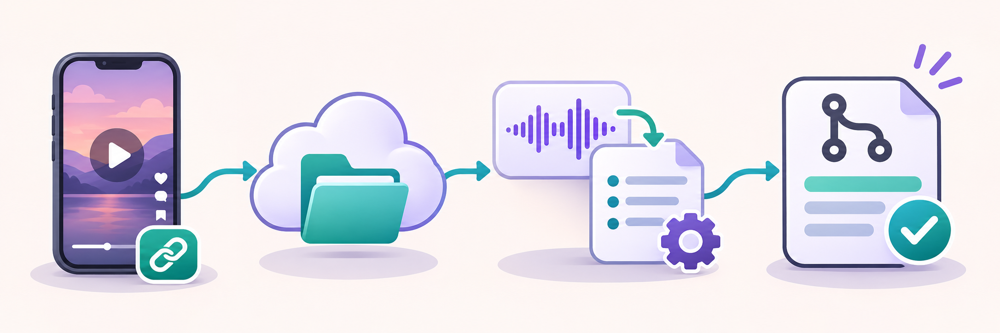

# Reel Skill Factory



Convierte videos y enlaces de Reels de Instagram en borradores de skills revisables en GitHub. Cada persona configura su propia carpeta de Drive como bandeja de entrada. Usa el extractor `video-a-skill` del autor como base: `yt-dlp` obtiene subtítulos o audio de los enlaces; FFmpeg extrae el audio de archivos locales y Whisper lo transcribe. Solo se genera una skill si el audio contiene un método reutilizable.

```text
Video del teléfono (.mp4/.mov) o enlace de Reel en un .txt → carpeta de Drive
  → Drive para escritorio → trabajador Python local
  → FFmpeg o yt-dlp + Whisper → Codex CLI → borrador de PR en GitHub
```

El correo y Apps Script son una **opción de entrada**, no requisitos: sirven para convertir el enlace compartido desde el teléfono en un `.txt` cuando no hay una acción móvil que lo guarde directamente en Drive.

El equipo debe estar encendido, conectado y con el trabajador activo (`watch` o tarea programada en Windows). Un Reel privado, retirado o inaccesible puede fallar. Las skills se proponen en **draft PRs**: nunca se fusionan ni instalan solas. El repositorio público recibe la skill, una fuente y un análisis breve; la transcripción completa se guarda en `.local-state/jobs/` y se envía a Codex, pero no se publica en el PR. Cada usuario autentica sus propias cuentas de Google, Codex y GitHub. La generación con Codex puede estar sujeta a límites o costos de su cuenta.

## Requisitos

- Windows, macOS o Linux. Recomendados 4 GB de RAM y 3 GB libres; el doctor informa la capacidad real.
- Windows: [WinGet](https://learn.microsoft.com/windows/package-manager/winget/). macOS: [Homebrew](https://brew.sh/). Linux: `apt`, `dnf` o `pacman`. El instalador prepara Python 3.11, Git, [GitHub CLI](https://cli.github.com/) y [Codex CLI](https://github.com/openai/codex) cuando faltan; en Windows/macOS también instala [Google Drive para escritorio](https://support.google.com/drive/answer/10838124). En Linux usa el instalador oficial de Codex.
- Cuenta Google para Drive y acceso de escritura al repositorio GitHub de destino. Gmail y Apps Script solo son necesarios si eliges la entrada por correo.
- Un Reel que `yt-dlp` pueda leer. No se usan cookies de navegador automáticamente.

## Instalar y comprobar viabilidad

1. Descarga el ZIP de este repositorio o clónalo si ya tienes Git, y abre una terminal en su carpeta. Ejecuta `./setup.ps1` en PowerShell o `sh setup.sh` en macOS/Linux. Si Windows bloquea la ejecución de scripts, usa `powershell -ExecutionPolicy Bypass -File .\setup.ps1` para esta ejecución. El script comprueba la versión de Python y el espacio libre antes de instalar. Prepara las herramientas externas que falten, crea `.venv`, instala `yt-dlp`, `openai-whisper` y un binario de FFmpeg incluido por `imageio-ffmpeg`, y descarga el modelo Whisper `base` para el primer uso. Si ya existe `config.local.json`, descarga el modelo elegido allí. No instala paquetes de nuevo cuando ya están disponibles.
   - Para posponer la descarga del modelo: `./setup.ps1 -SkipModelDownload` o `sh setup.sh --skip-model-download`.
   - Para usar otra sincronización o solo una carpeta local: `./setup.ps1 -SkipDriveDesktop` o `sh setup.sh --skip-drive-desktop`.
2. Ejecuta `gh auth login`, `gh auth setup-git` y `codex login` si aún no están autenticados. Configura el autor de Git con `git config --global user.name "Tu nombre"` y `git config --global user.email "tu@email"` si falta.
3. Crea una carpeta de Drive, por ejemplo `Reel Skill Factory/inbox`, y sincronízala con Drive para escritorio. Copia `config.example.json` a `config.local.json`; cambia `inbox_dir` por la ruta local real y `repository` por `OWNER/REPO`. `config.local.json` está excluido de Git. Para un segundo intento automático cuando la transcripción sea el motivo de `needs_review`, define `"review_whisper_model": "small"`. Es opcional: Whisper descargará ese modelo la primera vez que lo necesite y puede tardar más en computadores modestos.
4. Ejecuta `.\.venv\Scripts\python.exe -m reel_skill_factory doctor` en Windows o `.venv/bin/python -m reel_skill_factory doctor` en macOS/Linux. Opcionalmente añade `--url https://www.instagram.com/reel/CODIGO/` para probar la disponibilidad de un Reel público. El doctor comprueba autenticación de Codex/GitHub, repositorio, carpeta y extractor; la entrada desde el teléfono exige una prueba real.
5. Inicia el trabajador: en Windows ejecuta `./scripts/install-windows-task.ps1` para instalar una tarea de tu usuario que procesa la carpeta cada cinco minutos al iniciar sesión. Comprueba su estado con `Get-ScheduledTaskInfo -TaskName 'Reel Skill Factory'`; para quitarla usa `Unregister-ScheduledTask -TaskName 'Reel Skill Factory' -Confirm:$false`. En macOS/Linux ejecuta `.venv/bin/python -m reel_skill_factory watch` y déjalo abierto o agrégalo al inicio de sesión. También puedes ejecutar `watch` en Windows sin instalar la tarea. Para procesar una sola tanda usa `once`.

El instalador necesita internet y, según el sistema, puede pedir permisos para instalar aplicaciones. En Linux instala la versión de PyTorch para CPU, suficiente para Whisper sin descargar componentes CUDA. No puede iniciar sesión por ti en Google, GitHub ni Codex, elegir tu carpeta de Drive o comprobar el menú Compartir de tu teléfono. En Linux no hay un cliente oficial de Google Drive para escritorio: usa una carpeta local o configura una sincronización compatible por tu cuenta. Si el gestor de paquetes indicado no está disponible, el script se detiene con una instrucción concreta.

### Entrada directa por la carpeta de Drive

Desde iPhone o Android, sube a `inbox` un video que tengas derecho a usar en formato `.mp4`, `.mov`, `.m4v`, `.webm` o `.mkv`, de hasta 500 MB. Tras sincronizarse con el computador y permanecer sin cambios durante 30 segundos, el trabajador extrae el audio y lo transcribe. El archivo de video permanece en Drive; el borrador de PR solo lleva una huella SHA-256, el análisis y la skill. Conserva el video original para revisar el resultado antes de fusionar el PR.

También puedes colocar un archivo `.txt` con un solo enlace de Reel en `inbox`, por ejemplo `reel-001.txt`. El trabajador usa `yt-dlp` para obtener subtítulos o audio. Es una forma sencilla de probar enlaces desde el computador.

Si Instagram solo te ofrece **compartir el enlace**, eso no sube el video a Drive. Para la entrada directa, guarda primero un archivo de video al teléfono y súbelo desde la app de Drive. Para compartir solo el enlace, necesitas una acción que **cree un archivo de texto** en esa carpeta. En iPhone puedes explorar un atajo de la hoja Compartir que reciba URL/texto y use Guardar archivo en la ubicación de Google Drive disponible en Archivos. En Android, usa una acción o app que acepte texto compartido y lo guarde como `.txt` en Drive. Comprueba que el enlace terminó dentro del archivo; las opciones de Compartir cambian entre apps y versiones.

### Entrada opcional por correo desde iPhone y Android

Esta opción convierte el enlace que compartes desde Instagram en un `.txt` dentro de **tu misma carpeta de Drive**. Úsala si quieres compartir desde el teléfono sin crear el archivo manualmente.

1. En [Google Apps Script](https://script.google.com/), crea un proyecto nuevo y copia [Code.gs](google_apps_script/Code.gs). En **Project Settings → Script Properties**, define:

   | Propiedad | Valor |
   | --- | --- |
   | `INBOX_ADDRESS` | Una variante de tu Gmail, por ejemplo `nombre+reels@gmail.com` |
   | `ALLOWED_SENDER` | Tu dirección desde la que compartirás los Reels |
   | `DRIVE_FOLDER_ID` | ID de la carpeta `inbox` en su URL de Drive |

2. Ejecuta `install()` una vez desde el editor y autoriza Gmail/Drive. Crea un disparador cada cinco minutos. `install()` inicia el cursor en el momento actual: envía el primer enlace **después** de ejecutarlo. No necesitas desplegar un web app ni exponer un webhook.
3. En Instagram, abre un Reel, toca **Compartir → Compartir en... → Gmail/Mail**, envía el enlace a `INBOX_ADDRESS` y comprueba que aparece un `.txt` en la carpeta de Drive. Si Instagram no ofrece correo en tu teléfono, usa **Copiar enlace** dentro de Instagram y pégalo en un correo al mismo destino. El menú exacto depende de la versión de Instagram y del teléfono.

El correo de entrada debe salir de `ALLOWED_SENDER`. Apps Script elimina parámetros de seguimiento del enlace, evita archivos duplicados por ID de mensaje y nunca guarda el correo completo. Si tu dominio no permite direcciones con `+`, usa una dirección o alias propio y verificado.

## Resultado y revisión

Cada video apto crea una rama `skill/CODIGO` y un draft PR con `skills/<nombre>/SKILL.md` y `sources/CODIGO.md`. Para archivos locales, `CODIGO` deriva del SHA-256 del video; la fuente documenta la huella en vez de publicar el archivo. Para enlaces, la fuente contiene el URL. Ambos incluyen análisis y marcas de tiempo, sin transcripción completa. Antes de fusionar, revisa la fidelidad al video, utilidad de la skill, vigencia de plataformas/comandos y derechos de reutilización. Una opinión o video promocional sin método se registra como `not_skillable` en `.local-state/results.json` y no crea PR. Un caso ambiguo queda como `needs_review`. Cuando la duda proviene de la transcripción y configuraste `review_whisper_model`, el trabajador hace un segundo intento antes de dejarlo pendiente. Si ambos modelos discrepan entre `needs_review` y `not_skillable`, conserva el primero para revisión. Los errores no se repiten automáticamente; para reintentar todos los fallos usa `once --retry-failed`.

### Revisar y reintentar un video

`status` muestra el ID de cada video y su estado. Un trabajo que completó la transcripción y el análisis conserva `transcript.txt`, `analysis.md`, `result.json` y los intentos anteriores en `.local-state/jobs/ID/`. Estos archivos no se suben a GitHub. Para revisar un caso desde PowerShell:

```powershell
.\.venv\Scripts\python.exe -m reel_skill_factory status
.\.venv\Scripts\python.exe -m reel_skill_factory status CODIGO
.\.venv\Scripts\python.exe -m reel_skill_factory retry CODIGO --model small
```

En macOS/Linux usa `.venv/bin/python` en las mismas órdenes. Si el modelo aún deja errores, corrige manualmente `.local-state/jobs/CODIGO/transcript.txt`, conservando `[mm:ss]` al comienzo de cada línea, y ejecuta `retry CODIGO --use-transcript`. Ese reintento usa la edición sin descargar ni transcribir otra vez. Revisa la fidelidad al audio antes de editar: el programa no puede certificar una corrección humana. `retry` no modifica un video ya publicado; abre su PR para revisarlo. Los intentos previos se conservan bajo `attempts/`.

El worker usa una clonación temporal para cada PR y no modifica tu checkout. No lee ni sube cookies del navegador. La transcripción se envía a Codex CLI para generar el borrador; Codex se invoca en modo de solo lectura, sin comandos de shell y con búsqueda web activa para verificar detalles técnicos. El programa escribe únicamente los archivos del PR después de validar la estructura y las marcas de tiempo. Revisa todo contenido generado antes de usarlo.

La división de módulos, los estados y los límites de privacidad están en [Arquitectura](docs/ARCHITECTURE.md).

La licencia MIT cubre el contenido original de este repositorio. No concede derechos sobre los videos de terceros; quien publica una skill debe revisar su procedencia y su redacción.

## Pruebas

```bash
python -m unittest discover -s tests -v
```

Las pruebas locales cubren validación de enlaces, entrada de video, estados, reintentos y salida de generación. Una prueba completa requiere un video propio o Reel accesible, el teléfono, Drive sincronizado y autenticaciones activas; Gmail solo se necesita si eliges esa entrada.
